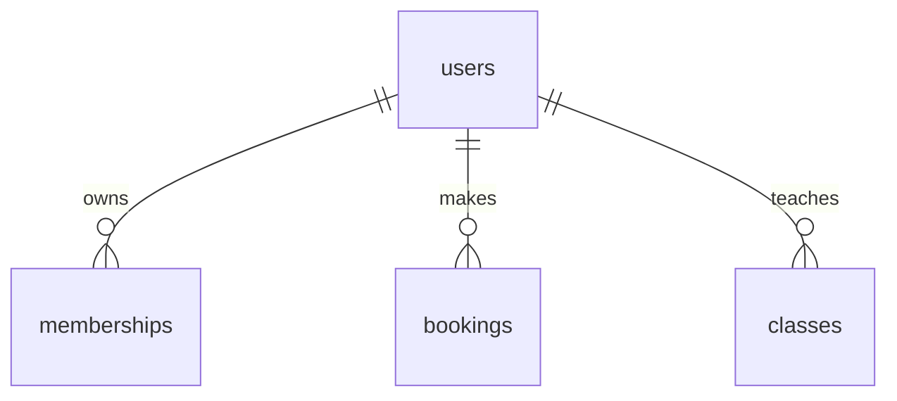

# Gym Booking Backend

Бэкенд проекта. Стек: Spring Boot 4, Java 21, Maven, Angular.

Структура:

- `controller` — эндпоинты
- `dto` — тела запросов из контракта с аннотациями валидации, enum'ы для query-параметров
- `error` — ошибки и их вывод текстом
- `repository` — SQL-доступ к PostgreSQL
- `src/main/resources/schema.sql` — SQL для создания таблиц

## Модель пользователей

- `users` — основная модель пользователя: `id`, `email`, `password_hash`, `role`, `created_at`, а также данные профиля `full_name` и `phone`.
- Отдельная таблица профиля сейчас не нужна: в проекте пока нет дополнительных полей, которые требовали бы отделить профиль от учётной записи.
- `memberships.user_id` и `bookings.user_id` ссылаются на `users.id`: один пользователь может иметь несколько абонементов и бронирований.
- `classes.trainer_id` ссылается на `users.id`; для этого пользователя бизнес-правило требует роль `TRAINER`.
- При удалении пользователя связанные с ним абонементы, бронирования и занятия удаляются внешними ключами с `ON DELETE CASCADE`.




адрес локального апи: http://localhost:8080/api/v1/

контракт апи лежит в ресурсах проекта по адресу src/main/resources/static
заготовка по фронтэнду пока не функционирует, но находится в процессе написания

## PostgreSQL

Создайте базу данных один раз:

```sql
CREATE DATABASE gym_db;
```

При запуске Spring Boot файл `schema.sql` автоматически создаст таблицы, если их
ещё нет. Для подключения задайте параметры вашей локальной PostgreSQL:

```sh
export DB_URL=jdbc:postgresql://localhost:5432/gym_db
export DB_USERNAME="$(whoami)"
export DB_PASSWORD=
mvn spring-boot:run
```

Для другой установки PostgreSQL укажите имя пользователя и пароль, заданные при
настройке сервера.

## API

Базовый адрес: `http://localhost:8080/api/v1`

| Метод | Путь | Что делает | Успешный ответ |
|---|---|---|---|
| POST | /auth/register | Регистрация клиента | 201 |
| POST | /auth/login | Вход по email и паролю | 200 |
| POST | /auth/refresh | Новая пара токенов по refresh-токену | 200 |
| POST | /auth/logout | Выход | 204 |
| GET | /users/me | Мой профиль | 200 |
| PATCH | /users/me | Изменить имя / телефон | 200 |
| GET | /users | Список пользователей (role, q, limit, offset) | 200 |
| PATCH | /users/{userId}/role | Сменить роль пользователя | 200 |
| GET | /trainers | Список тренеров (specialization, limit, offset) | 200 |
| POST | /trainers | Сделать пользователя тренером | 201 |
| GET | /trainers/{trainerId} | Тренер по id | 200 |
| PATCH | /trainers/{trainerId} | Изменить тренера | 200 |
| GET | /classes | Расписание (from, to, trainerId, type, onlyAvailable, limit, offset) | 200 |
| POST | /classes | Создать занятие | 201 |
| GET | /classes/{classId} | Занятие по id | 200 |
| PATCH | /classes/{classId} | Изменить занятие | 200 |
| POST | /classes/{classId}/cancel | Отменить занятие | 200 |
| GET | /classes/{classId}/bookings | Записи на занятие | 200 |
| POST | /bookings | Записаться на занятие | 201 |
| GET | /users/me/bookings | Мои записи (status, upcoming, limit, offset) | 200 |
| GET | /bookings/{bookingId} | Запись по id | 200 |
| POST | /bookings/{bookingId}/cancel | Отменить запись | 200 |
| GET | /membership-plans | Тарифы абонементов | 200 |
| POST | /memberships | Купить абонемент | 201 |
| GET | /users/me/memberships | Мои абонементы | 200 |
| POST | /access/qr-token | QR-токен для входа (живёт 60 сек) | 200 |
| POST | /access/check-in | Проверка QR на входе (GRANTED / DENIED) | 200 |
| GET | /access/visits | Журнал посещений (userId, from, to, limit, offset) | 200 |
| GET | /device-providers | Поддерживаемые устройства | 200 |
| GET | /users/me/devices | Мои устройства | 200 |
| POST | /users/me/devices | Подключить устройство | 201 |
| DELETE | /users/me/devices/{deviceId} | Отключить устройство | 204 |
| POST | /users/me/devices/{deviceId}/sync | Синхронизировать устройство | 200 |
| GET | /users/me/metrics | Мои метрики (type, from, to, bookingId) | 200 |
## Frontend